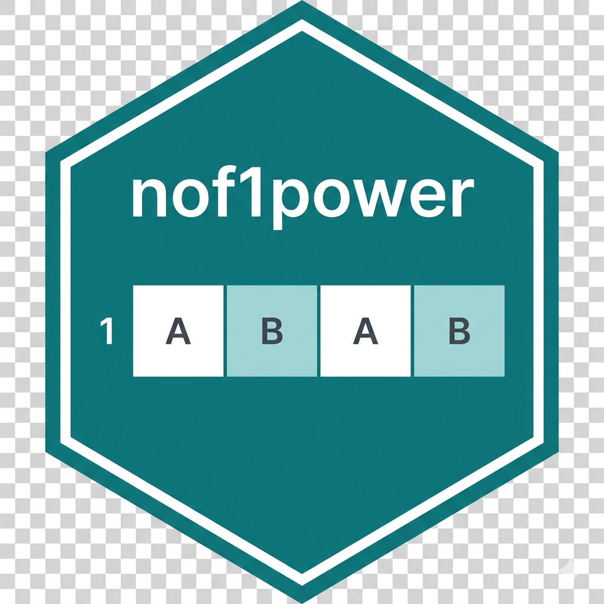

# nof1power <a href="https://github.com/rgt47/nof1power"></a>

Power Analysis and Simulation for N-of-1 Trials

## Overview

`nof1power` is a research compendium, in an early scaffold stage, for
work on power analysis and simulation for N-of-1 clinical trial
designs. N-of-1 trials are randomized crossover trials conducted in
individual patients, useful for determining optimal treatments for
individual patients.

**Current status.** The repository contains the zzcollab compendium
scaffolding (R package metadata, Docker and renv configuration, and
an `analysis/` directory tree) but no analysis code, data, or package
functions yet. `R/utils.R` is a placeholder, and the package exports
no functions. The R package structure exists to support the
reproducibility tooling; the intended deliverable is the analysis
under `analysis/`, not a reusable library.

## Planned features

The following are planned and **not yet implemented**:

- Power calculation for N-of-1 crossover designs
- Sample size estimation
- Monte Carlo simulation for complex designs
- Visualization of power curves

## Installation

```r
devtools::install_github("rgt47/nof1power")
```

Installing the package currently provides no user-facing functions.

## Research Compendium

This repository is structured as a reproducible research compendium
using the zzcollab framework. The `analysis/` directory is laid out
as follows; apart from `analysis/data/README.md`, these directories
are currently empty:

- `analysis/data/` - Raw and derived data
- `analysis/scripts/` - Analysis code
- `analysis/report/` - Manuscript and reports
- `analysis/figures/` - Generated visualizations
- `analysis/tables/` - Generated tables

## Development

```bash
# Start Docker container
make r

# Run tests
make docker-test

# Build documentation
make docker-document
```

## License

GPL (>= 3)

## Author

Ronald (Ryy) G. Thomas (rgthomas@ucsd.edu)
